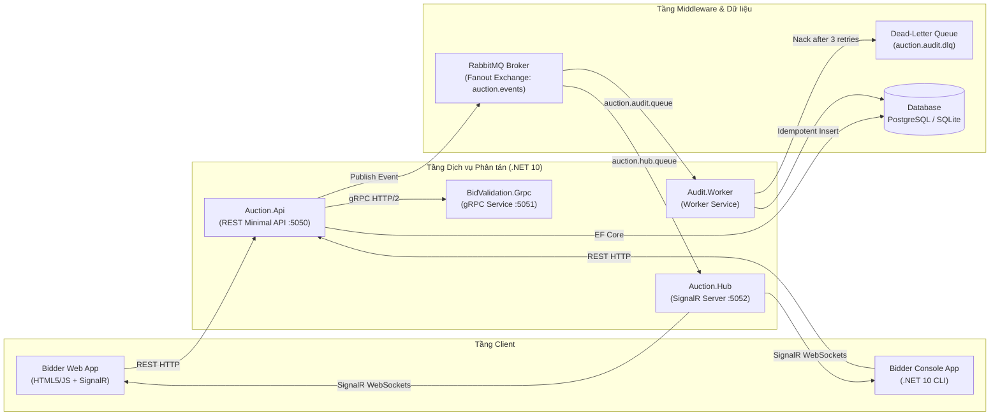

# BÁO CÁO BÀI TẬP LỚN
## HỌC PHẦN: PHÁT TRIỂN ỨNG DỤNG PHÂN TÁN
### ĐỀ TÀI 10: HỆ THỐNG ĐẤU GIÁ TRỰC TUYẾN (ONLINE AUCTION SYSTEM)

---

## CHƯƠNG 1. MÔ TẢ BÀI TOÁN VÀ PHÂN TÍCH YÊU CẦU

### 1.1. Đặt vấn đề
Trong các hệ thống đấu giá trực tuyến thời gian thực (Realtime Online Auction), nhiều người dùng cùng theo dõi một phiên đấu giá và gửi mức giá đặt mới đồng thời. Hệ thống cần giải quyết các bài toán cốt lõi của một hệ phân tán:
1. **Tiếp nhận yêu cầu trả giá nhanh chóng** từ nhiều loại thiết bị/client khác nhau (Web App, Console App).
2. **Kiểm tra tính hợp lệ của lượt trả giá độc lập và chính xác** (trạng thái phiên, khung thời gian hiệu lực, mức giá tối thiểu hợp lệ dựa trên bước giá).
3. **Phát tán sự kiện thay đổi giá bất đồng bộ (Event-Driven)** để không làm nghẽn luồng xử lý chính của API.
4. **Cập nhật giá mới theo thời gian thực (Realtime Push)** tới tất cả người đang theo dõi phiên đấu giá.
5. **Lưu vết lịch sử (Audit Trail) tin cậy**, không bị trùng lặp (Idempotent) và có khả năng xử lý lỗi (Retry / Dead-Letter Queue).

### 1.2. Các chức năng chính của hệ thống
1. **Tạo và tra cứu phiên đấu giá**: Cho phép tạo mới phiên đấu giá với thông tin sản phẩm, giá khởi điểm, bước giá tối thiểu, thời gian bắt đầu/kết thúc; tra cứu danh sách và chi tiết từng phiên.
2. **Tham gia theo dõi phiên đấu giá đang mở**: Client kết nối vào phòng đấu giá qua SignalR Hub để nhận thông báo realtime.
3. **Gửi mức giá mới qua REST API**: Người tham gia gửi yêu cầu đặt giá qua endpoint `POST /auctions/{id}/bids`.
4. **Kiểm tra lượt trả giá độc lập qua gRPC**: `Auction API` gọi `Bid Validation Service` bằng giao thức gRPC (HTTP/2) để xác thực luật nghiệp vụ.
5. **Lưu mức giá hợp lệ và phát sự kiện `BidAccepted` qua RabbitMQ**: Khi lượt trả giá hợp lệ, `Auction API` cập nhật giá hiện tại và phát sự kiện vào Exchange `auction.events`.
6. **Cập nhật realtime qua SignalR**: `Auction Hub` tiêu thụ sự kiện từ RabbitMQ và đẩy mức giá mới đến các Client đang theo dõi.
7. **Ghi nhận lịch sử qua `Audit Worker`**: Dịch vụ nền độc lập tiêu thụ sự kiện từ RabbitMQ để lưu lịch sử trả giá và sự kiện kết thúc phiên vào cơ sở dữ liệu.
8. **Kết thúc phiên đấu giá và xác định người chiến thắng**: Hỗ trợ tự động đóng phiên khi hết thời gian hoặc kết thúc theo yêu cầu (`POST /auctions/{id}/end`), phát sự kiện `AuctionEnded` và cho phép tra cứu kết quả.

---

## CHƯƠNG 2. KIẾN TRÚC HỆ THỐNG VÀ THIẾT KẾ THÀNH PHẦN

### 2.1. Sơ đồ kiến trúc tổng thể

```text
Bidder Clients -> Auction API -> gRPC -> Bid Validation Service
      ^               |
      | SignalR       | BidAccepted / AuctionEnded Event
      +-- Auction Hub <- RabbitMQ -> Audit Worker
                         |
                         v
                      Database
```



### 2.2. Thiết kế chi tiết các thành phần

| STT | Tên Project / Thành phần | Công nghệ | Vai trò chính |
| :-: | :--- | :--- | :--- |
| 1 | `Shared.Contracts` | .NET 10 Class Library, EF Core | Định nghĩa Entities (`AuctionItem`, `BidRecord`, `AuditLogEntry`, `OutboxEventMessage`), DTOs, Events (`BidAcceptedEvent`, `AuctionEndedEvent`) và cấu hình Database. |
| 2 | `BidValidation.Grpc` | ASP.NET Core gRPC (.NET 10) | Dịch vụ độc lập lắng nghe HTTP/2 tại cổng `5051`, thực thi RPC `ValidateBid` và `CheckHealth` theo hợp đồng `bid_validation.proto`. |
| 3 | `Auction.Api` | ASP.NET Core Minimal API (.NET 10) | Cung cấp các REST API quản lý phiên đấu giá và đặt giá tại cổng `5050`, gọi `BidValidation.Grpc`, phát sự kiện lên RabbitMQ và chạy `AuctionExpirationService` tự động kết thúc phiên hết hạn. |
| 4 | `Auction.Hub` | ASP.NET Core SignalR (.NET 10) | Lắng nghe hàng đợi `auction.hub.queue` từ RabbitMQ, phát sóng sự kiện `BidAccepted` và `AuctionEnded` tới các trình duyệt Web App và Console Client qua WebSockets tại `/hubs/auction` (cổng `5052`). |
| 5 | `Audit.Worker` | .NET 10 Worker Service | Lắng nghe hàng đợi `auction.audit.queue`, đảm bảo tính chất **Idempotent Consumer** theo `EventId`, hỗ trợ **Retry 3 lần** và chuyển tiếp lỗi sang **Dead-Letter Queue (`auction.audit.dlq`)**. |
| 6 | `Bidder.ConsoleClient` | .NET 10 Console App | Ứng dụng dòng lệnh tương tác REST + SignalR và tích hợp kịch bản kiểm thử tự động toàn trình (`--auto-demo`). |

### 2.3. Thiết kế Cơ sở dữ liệu
Hệ thống sử dụng Entity Framework Core hỗ trợ đồng thời **PostgreSQL** (khi triển khai trên Docker Compose) và **SQLite WAL Mode** (khi chạy trực tiếp trên máy cá nhân), gồm 4 bảng chính:
1. **`Auctions` (`AuctionItem`)**: Lưu thông tin sản phẩm (`ProductName`, `ProductDescription`), giá khởi điểm (`StartingPrice`), giá hiện tại (`CurrentPrice`), bước giá tối thiểu (`MinIncrement`), người đang dẫn đầu (`CurrentWinner`), tổng số lượt trả (`TotalBids`), thời gian bắt đầu/kết thúc (`StartTimeUtc`, `EndTimeUtc`) và trạng thái (`Open` / `Closed`).
2. **`Bids` (`BidRecord`)**: Lưu từng lượt trả giá hợp lệ (`Id`, `AuctionId`, `BidderName`, `Amount`, `PlacedAtUtc`, `CorrelationId`).
3. **`AuditLogs` (`AuditLogEntry`)**: Bảng lịch sử kiểm toán do `Audit.Worker` ghi nhận, đánh `Unique Index` trên cột `EventId` để chống ghi trùng lặp.
4. **`OutboxEvents` (`OutboxEventMessage`)**: Bảng hỗ trợ cơ chế chịu lỗi (Outbox Pattern) khi RabbitMQ tạm thời ngừng hoạt động.

---

## CHƯƠNG 3. CÁC CƠ CHẾ GIAO TIẾP PHÂN TÁN ĐÃ SỬ DỤNG

### 3.1. Giao tiếp đồng bộ Client - Server qua REST Minimal API
- Sử dụng định dạng JSON nhẹ, chuẩn hóa các mã trạng thái HTTP (`200 OK`, `201 Created`, `400 Bad Request`, `404 Not Found`, `503 Service Unavailable`).
- Tích hợp Middleware tự động sinh và truyền `X-Correlation-ID` trong HTTP Header để liên kết toàn bộ nhật ký xử lý giữa các tiến trình.

### 3.2. Giao tiếp đồng bộ Nội bộ giữa các Service qua gRPC (HTTP/2 + Protocol Buffers)
- File hợp đồng `Protos/bid_validation.proto` định nghĩa dịch vụ `BidValidator` với phương thức `ValidateBid(ValidateBidRequest) returns (ValidateBidResponse)`.
- Ưu điểm: Tốc độ tuần tự hóa nhị phân (Protobuf) cực nhanh, kiểu dữ liệu chặt chẽ (Strongly-typed contract), rất phù hợp cho tác vụ kiểm tra điều kiện trả giá nội bộ giữa `Auction.Api` và `BidValidation.Grpc`.

### 3.3. Giao tiếp bất đồng bộ hướng sự kiện (Event-Driven) qua RabbitMQ
- `Auction.Api` đóng vai trò **Publisher**, phát `AuctionEventEnvelope` lên **Fanout Exchange** có tên `auction.events` với thuộc tính `Persistent = true`.
- Exchange `auction.events` nhân bản bản tin tới 2 hàng đợi độc lập:
  1. `auction.hub.queue`: Được tiêu thụ bởi `Auction.Hub` để thông báo realtime.
  2. `auction.audit.queue`: Được tiêu thụ bởi `Audit.Worker` để lưu lịch sử.
- Thiết kế này giúp tách rời hoàn toàn (Loose Coupling) giữa luồng đặt giá với luồng thông báo và luồng ghi nhật ký kiểm toán.

### 3.4. Giao tiếp hai chiều thời gian thực qua ASP.NET Core SignalR
- Khi `Auction.Hub` nhận sự kiện từ RabbitMQ, Hub đẩy ngay lập tức sự kiện `BidAccepted` hoặc `AuctionEnded` xuống tất cả các `Bidder Clients` đang kết nối mà không cần Client phải gửi request hỏi thăm định kỳ (Polling).

---

## CHƯƠNG 4. CÁC YÊU CẦU MỞ RỘNG VÀ KHẢ NĂNG CHỊU LỖI (RESILIENCE)

1. **Correlation ID xuyên suốt (Distributed Tracing)**:
   - Từ lúc Client gọi `POST /auctions/{id}/bids` -> `Auction.Api` -> `BidValidation.Grpc` -> `RabbitMQ` -> `Auction.Hub` & `Audit.Worker`, cùng một mã `CorrelationId` được ghi vào log của tất cả các service.
2. **Idempotent Consumer trên `Audit.Worker` và `Auction.Hub`**:
   - Nếu RabbitMQ gửi lại cùng một thông điệp (At-least-once delivery), `Audit.Worker` kiểm tra `EventId` trong bảng `AuditLogs` (có `Unique Index`). Nếu đã tồn tại, Worker bỏ qua an toàn và `BasicAck` thông điệp.
3. **Cơ chế Retry và Dead-Letter Queue (DLQ)**:
   - Hàng đợi `auction.audit.queue` được cấu hình `x-dead-letter-exchange = auction.dlx`.
   - Khi gặp lỗi xử lý, `Audit.Worker` thực hiện thử lại tối đa 3 lần (`MaxRetryCount = 3`) với thời gian chờ tăng dần. Nếu vẫn thất bại, Worker gọi `BasicNack(requeue: false)` để RabbitMQ tự động chuyển bản tin lỗi sang hàng đợi `auction.audit.dlq`.
4. **Khả năng phục hồi khi một thành phần tạm dừng hoạt động**:
   - **Khi `BidValidation.Grpc` tạm dừng**: `Auction.Api` bắt ngoại lệ `RpcException`, ghi log cảnh báo và chuyển sang chế độ kiểm tra dự phòng tại chỗ (`FallbackValidation`) nếu được bật trong cấu hình, giúp hệ thống không bị tê liệt.
   - **Khi `RabbitMQ` tạm dừng**: `Auction.Api` vẫn lưu lượt trả giá vào Database cùng bản ghi `OutboxEventMessage (PublishedToBroker = false)`. Khi RabbitMQ hoạt động trở lại, `AuctionExpirationService` tự động đẩy bù các sự kiện chưa phát lên RabbitMQ.

---

## CHƯƠNG 5. KẾT QUẢ THỰC HIỆN VÀ KỊCH BẢN TRÌNH BÀY KHI BẢO VỆ

### 5.1. Kịch bản minh họa trực tiếp khi thi vấn đáp
1. **Bước 1 - Khởi chạy hệ thống**:
   - Chạy `docker compose up --build -d` (hoặc `.\start-local.ps1` trên Windows).
   - Mở trình duyệt tại `http://localhost:5052` (nhân đôi thành 2 cửa sổ trình duyệt cạnh nhau để đóng vai 2 người đấu giá khác nhau) và mở thêm 1 cửa sổ `Bidder.ConsoleClient`.
2. **Bước 2 - Tạo và tra cứu phiên đấu giá**:
   - Nhấn nút **"+ Tạo phiên đấu giá"** trên Web App (hoặc phím `5` trên Console App) -> Gọi `POST /auctions`.
   - Danh sách phiên đấu giá cập nhật qua `GET /auctions`.
3. **Bước 3 - Kiểm tra gRPC từ chối mức giá không hợp lệ**:
   - Nhấn nút **"🧪 Thử giá thấp (Test gRPC từ chối)"** và bấm **Gửi Mức Giá Mới**.
   - Quan sát thông báo lỗi trả về từ `BidValidation.Grpc` (`BID_TOO_LOW`) kèm `CorrelationId` trên giao diện và trên cửa sổ log của `BidValidation.Grpc`.
4. **Bước 4 - Đặt giá hợp lệ và cập nhật Realtime qua RabbitMQ + SignalR**:
   - Chọn mức giá hợp lệ (`+1 Bước giá`) và nhấn **Gửi Mức Giá Mới**.
   - Cả 2 cửa sổ trình duyệt Web và cửa sổ Console App đều nhận thông báo `BidAccepted` tức thì qua SignalR!
   - Bảng **Nhật ký Audit Worker** phía dưới tự động hiển thị bản ghi lịch sử do `Audit.Worker` lưu lại.
5. **Bước 5 - Kết thúc phiên đấu giá và xác định người thắng**:
   - Nhấn nút **"⏹ Kết thúc phiên & Chốt người thắng"** (`POST /auctions/{id}/end`).
   - Sự kiện `AuctionEnded` được phát qua RabbitMQ -> SignalR hiển thị thông báo người chiến thắng chung cuộc trên mọi Client và `Audit.Worker` ghi nhận sự kiện kết thúc phiên.
