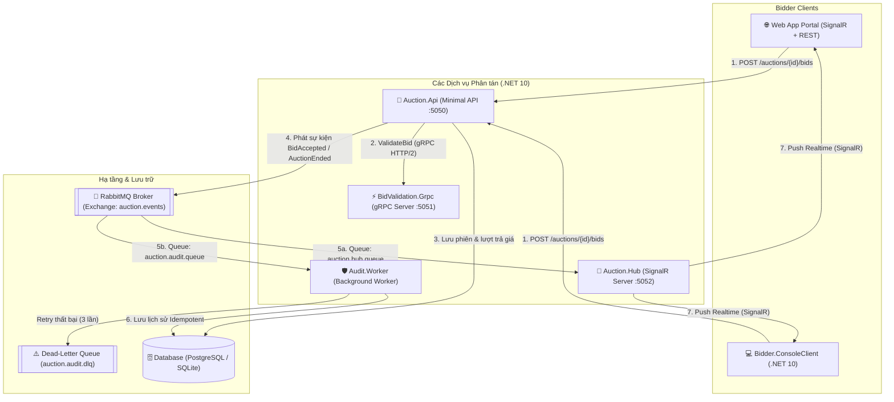

# Đề tài 10 - Hệ thống Đấu giá Trực tuyến (.NET 10 Distributed System)

Dự án Bài tập lớn học phần **Phát triển ứng dụng phân tán** xây dựng trên nền tảng **C# / .NET 10**, kết hợp đầy đủ các cơ chế giao tiếp phân tán hiện đại: **REST Minimal API**, **gRPC**, **RabbitMQ (Fanout Exchange + Retry + Dead-Letter Queue)** và **SignalR Realtime**.

---

## 1. Kiến trúc tổng thể của hệ thống

```text
Bidder Clients (Web App & Console App)
      ^                        |
      | SignalR Realtime       | REST API (HTTP JSON)
      | (/hubs/auction)        v
      |                   Auction API (Minimal API - Port 5050)
      |                        |
      |                        +---> gRPC (HTTP/2) ---> Bid Validation Service (Port 5051)
      |                        |
      |                        | BidAccepted / AuctionEnded Event
      |                        v
Auction Hub (Port 5052) <--- RabbitMQ (Exchange: auction.events) ---> Audit Worker (Idempotent + DLQ)
                               |
                               v
                   Database (PostgreSQL / SQLite)
```

### Sơ đồ luồng xử lý (Mermaid)



---

## 2. Cấu trúc thư mục dự án

```text
├── OnlineAuctionSystem.slnx                  # Solution .NET 10
├── docker-compose.yml                        # Khởi chạy toàn bộ hệ thống bằng Docker Compose
├── start-local.ps1                           # Script chạy nhanh toàn bộ hệ thống trên Windows
├── stop-local.ps1                            # Script dừng toàn bộ tiến trình đang chạy local
├── README.md                                 # Tài liệu hướng dẫn cài đặt, build và chạy
├── BAO_CAO_BTL.md                            # Nội dung Quyển báo cáo Bài tập lớn chi tiết
└── src/
    ├── Shared.Contracts/                     # Entities, DTOs, Events, DbContext, RabbitMQ Config
    ├── BidValidation.Grpc/                   # Dịch vụ gRPC kiểm tra lượt trả giá độc lập + Dockerfile
    ├── Auction.Api/                          # ASP.NET Core Minimal API + gRPC Client + RabbitMQ Publisher + Dockerfile
    ├── Auction.Hub/                          # Dịch vụ SignalR Hub + RabbitMQ Consumer + Giao diện Web App + Dockerfile
    ├── Audit.Worker/                         # Worker lưu lịch sử trả giá & kết thúc phiên (Idempotent + DLQ) + Dockerfile
    └── Bidder.ConsoleClient/                 # Ứng dụng Console Client theo dõi & đặt giá trực tiếp
```

---

## 3. Danh sách API của `Auction.Api` (Port `5050`)

| Phương thức | Endpoint | Mô tả chức năng |
| :--- | :--- | :--- |
| `POST` | `/auctions` | Tạo phiên đấu giá mới |
| `GET` | `/auctions` | Tra cứu danh sách các phiên đấu giá (hỗ trợ `?status=Open\|Closed`) |
| `GET` | `/auctions/{id}` | Tra cứu thông tin chi tiết một phiên đấu giá |
| `POST` | `/auctions/{id}/bids` | Gửi mức giá mới -> Gọi `BidValidation.Grpc` kiểm tra -> Lưu DB -> Phát sự kiện `BidAccepted` qua RabbitMQ |
| `GET` | `/auctions/{id}/bids` | Lấy danh sách lịch sử lượt trả giá của phiên đấu giá |
| `POST` | `/auctions/{id}/end` | Kết thúc phiên đấu giá, xác định người chiến thắng và phát sự kiện `AuctionEnded` |
| `GET` | `/auctions/{id}/result` | Tra cứu kết quả phiên đấu giá và người chiến thắng |
| `GET` | `/audit-logs` | Tra cứu nhật ký Audit Log đã được `Audit.Worker` xử lý |
| `GET` | `/health` | Kiểm tra trạng thái hoạt động (Health Check) của dịch vụ |

---

## 4. Hướng dẫn Cài đặt, Build và Khởi chạy Hệ thống

Hệ thống được thiết kế linh hoạt để chạy theo **2 cách**:
- **Cách 1 (Triển khai chuẩn bằng Docker Compose)**: Khởi chạy PostgreSQL, RabbitMQ và 4 container dịch vụ .NET 10 qua mạng nội bộ Docker (`auction-net`).
- **Cách 2 (Chạy trực tiếp bằng .NET 10 CLI trên máy tính cá nhân)**: Hữu ích khi demo nhanh hoặc máy chưa bật Docker Desktop (tự động sử dụng CSDL SQLite dùng chung ở chế độ WAL và cơ chế Outbox/RabbitMQ linh hoạt).

### Cách 1: Khởi chạy bằng Docker Compose

1. Mở Docker Desktop trên máy tính.
2. Tại thư mục gốc của dự án, chạy lệnh:
   ```powershell
   docker compose up --build -d
   ```
3. Kiểm tra trạng thái các container:
   ```powershell
   docker compose ps
   ```
4. Truy cập các thành phần của hệ thống:
   - **Giao diện Web App Đấu giá Trực tuyến**: http://localhost:5052
   - **Auction REST Minimal API**: http://localhost:5050/auctions
   - **BidValidation gRPC Health Check**: http://localhost:5151/health
   - **RabbitMQ Management UI**: http://localhost:15672 (Tài khoản: `guest` / `guest`)

### Cách 2: Khởi chạy trực tiếp bằng .NET 10 trên Windows (Chỉ 1 lệnh)

1. Build toàn bộ Solution:
   ```powershell
   dotnet build
   ```
2. Khởi chạy đồng thời cả 4 dịch vụ (`BidValidation.Grpc`, `Auction.Api`, `Auction.Hub`, `Audit.Worker`) và mở giao diện Web App bằng script tự động:
   ```powershell
   .\start-local.ps1
   ```
3. Mở thêm ứng dụng **Console Client** để kiểm thử song song với Web App:
   ```powershell
   dotnet run --project src/Bidder.ConsoleClient
   ```
   *(Hoặc chạy kịch bản kiểm thử tự động toàn trình từ đầu đến cuối bằng lệnh)*:
   ```powershell
   dotnet run --project src/Bidder.ConsoleClient -- --auto-demo
   ```
4. Để dừng toàn bộ dịch vụ đang chạy local:
   ```powershell
   .\stop-local.ps1
   ```

---

## 5. Các yêu cầu mở rộng đã được tích hợp đầy đủ

1. **Retry & Dead-Letter Queue (DLQ)**: `Audit.Worker` tự động thử lại tối đa 3 lần với độ trễ tăng dần khi xử lý sự kiện thất bại; nếu vẫn lỗi sẽ đẩy sang `auction.dlx` -> `auction.audit.dlq`.
2. **Idempotent Consumer**: Mỗi sự kiện phát đi có `EventId` duy nhất; cả `Auction.Hub` và `Audit.Worker` đều kiểm tra chống xử lý trùng lặp (`Unique Index` trên cột `EventId` của bảng `AuditLogs`).
3. **Correlation ID xuyên suốt**: Mọi yêu cầu REST đều sinh hoặc nhận header `X-Correlation-ID`, truyền qua gRPC (`ValidateBidRequest.correlation_id`), đóng gói vào `AuctionEventEnvelope` trên RabbitMQ và hiển thị tới tận SignalR Client cũng như `Audit.Worker`.
4. **Health Check**: Các dịch vụ cung cấp endpoint `/health` và gRPC `CheckHealth`.
5. **Khả năng chịu lỗi & Phục hồi (Fault Tolerance / Graceful Degradation)**:
   - Khi `RabbitMQ` tạm thời dừng hoạt động: `Auction.Api` tự động lưu sự kiện vào bảng `OutboxEvents` và tự động gửi bù (`FlushPendingOutboxEventsAsync`) ngay khi RabbitMQ hoạt động trở lại.
   - Khi `BidValidation.Grpc` tạm thời dừng hoạt động: `Auction.Api` bắt ngoại lệ `RpcException`, ghi log cảnh báo và kích hoạt chế độ kiểm tra dự phòng tại chỗ (`FallbackValidation`) để phiên đấu giá không bị gián đoạn.
